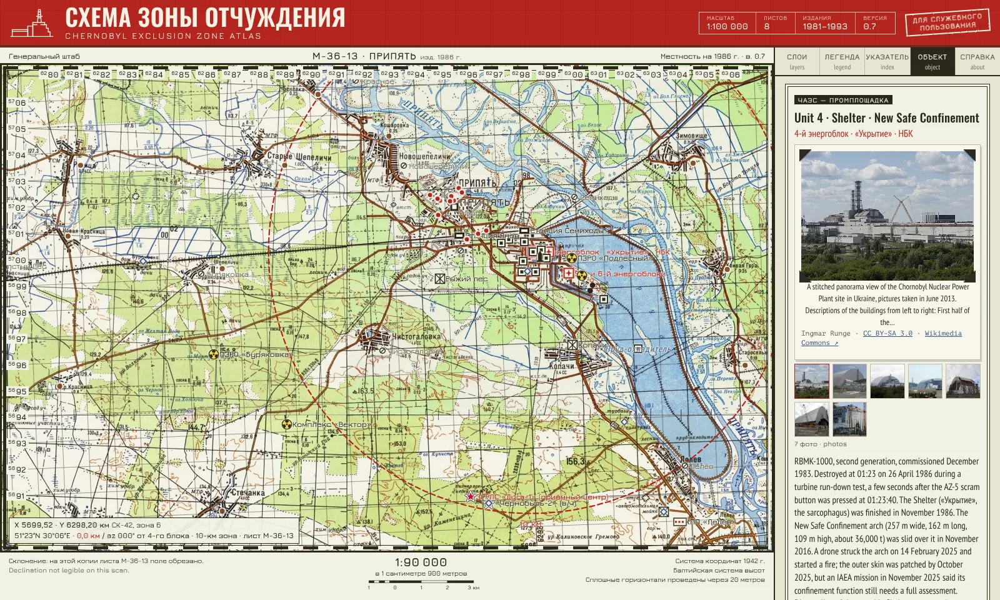

# Chernobyl Zone Atlas · Схема Зоны Отчуждения

**[Open the atlas →](https://renderedsheep.github.io/chernobyl-atlas/)**

**Version 0.7.1** · November 2026 · Built by Fernand Gouveia

An interactive atlas of the Chernobyl exclusion zone for people visiting the zone and those who can only visit virtually. It is drawn on eight Soviet General Staff military topographic sheets at 1:100 000 (editions 1981–1993), joined and aligned to modern coordinates, with:

- the power plant, its units, stores and switchyards, plus a clickable site schematic;
- Pripyat landmarks, the Duga radar, waste sites, checkpoints, memorials and liquidation sites, each with a short entry and photographs;
- 208 settlements read by hand from the sheets, with their printed populations;
- the 1986 caesium-137 fallout traces (schematic), a kilometre grid in the Soviet СК-42 system, and sheet margins with magnetic declination and a live scale.

Companion to the [SKALA simulator](https://github.com/renderedsheep/skala-simulator), a recreation of the Chernobyl plant's control computer.

**Spotted a mistake or know something that's missing?** Use the *Spotted a mistake?* links on any object card, click the map for a link at that spot, or [open a suggestion here](https://github.com/renderedsheep/chernobyl-atlas/issues/new/choose). A free GitHub account is needed. Every suggestion is checked before anything changes on the map.

## Editing the map
Open `editor.html` in Chrome or Edge on a computer, working on a local copy of the repository.

- **Объекты / sites**, **Сёла / settlements**, **Линии / lines**: click any item on the map or in the list to edit it; drag a marker to move it.
- **Draw line / Draw area**: click point by point, then press Enter. Styles include road, fence, forest, water and three radiation bands.
- **Photos**: add them inside any item; they are shrunk to 1100 px WebP. Fill in author and licence.
- **Save** writes `data/atlas-data.js` and new photos into the folder, and keeps a backup in `data/backups/` (ignored by git).

Then commit and push the changed files.

## How suggestions work
Each object card, the map (click anywhere) and the Справка tab link to four short GitHub forms: correct a location, add a site, add a photo, other. The links pre-fill the object name and coordinates. The forms live in `.github/ISSUE_TEMPLATE/`; suggestions arrive in the repository's **Issues** tab. See [CONTRIBUTING.md](CONTRIBUTING.md).

## Layout
| Path | Contents |
|---|---|
| `index.html` | The atlas |
| `editor.html` | The editor |
| `data/atlas-data.js` | All editable content: sites, settlements, sheets, lines and areas, photo credits |
| `data/water.js` | Water outlines traced from the sheets |
| `tiles/` | Base map tiles (1024 px WebP), file zooms 6–11 |
| `photos/` | Photographs (WebP) |
| `docs/` | The screenshot used in this README |
| `tools/` | Python scripts and source scans that build the tiles and water layer (see `tools/README.md`) |

Not editable in the editor: the base map, traced water, the schematic radiation traces, the 10/30 km circles, the legend wording and the Справка page text. Those live in `index.html`.

## Accuracy
Positions are tagged in each entry as published, read from a sheet (±150–200 m) or estimated. A kilometre grid computed independently from the coordinates lands on the grid printed on the sheets. The radiation layer is a hand-drawn schematic, not survey data; the Kashparov et al. (2018) dataset is the right source for a measured layer.

## Licence
- **Code** (`index.html`, `editor.html`, `tools/*.py`): [Apache License 2.0](LICENSE).
- **Text and data** (`data/atlas-data.js`, `data/water.js`, `tools/readings/`, the written text in the pages and these documents): [CC BY-SA 4.0](LICENSE-CONTENT). Credit as “Chernobyl Zone Atlas by Fernand Gouveia, CC BY-SA 4.0”.
- **Not covered:** photographs in `photos/` keep their own licences (see [CREDITS.md](CREDITS.md)); the map scans and tiles in `tools/src/` and `tiles/` are third-party material of uncertain copyright status and are not licensed by the author. The screenshot in `docs/` shows both (the photo is by Ingmar Runge, CC BY-SA 3.0, via Wikimedia Commons).

Details in [NOTICE](NOTICE).

## Посвящение · Dedication
This atlas is dedicated to everyone who has worked to preserve Chernobyl's history - the engineering, people & culture - with care and respect, and to record it for future generations.
